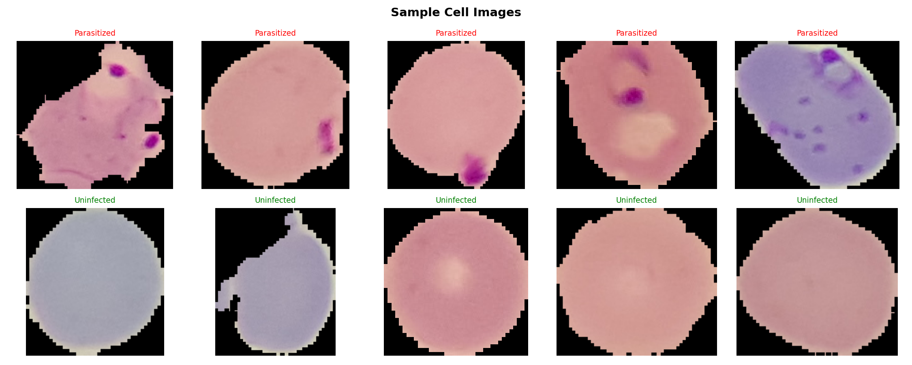
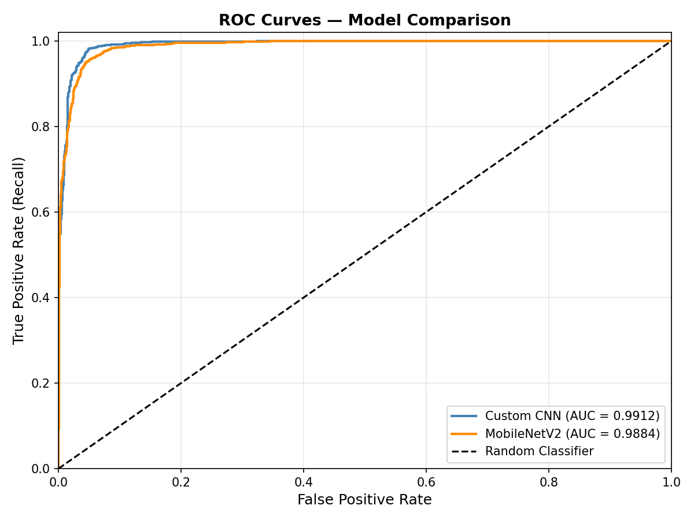
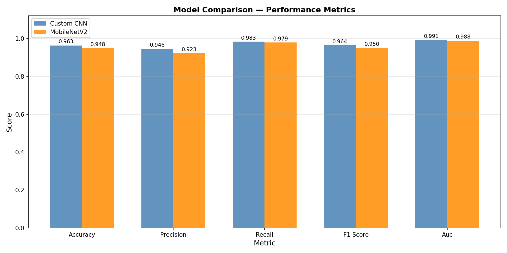
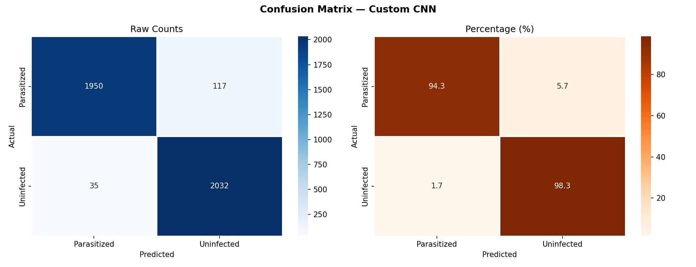
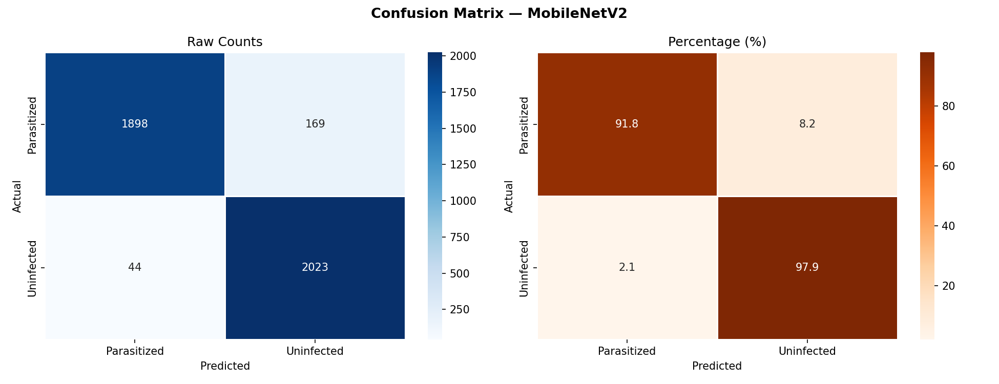
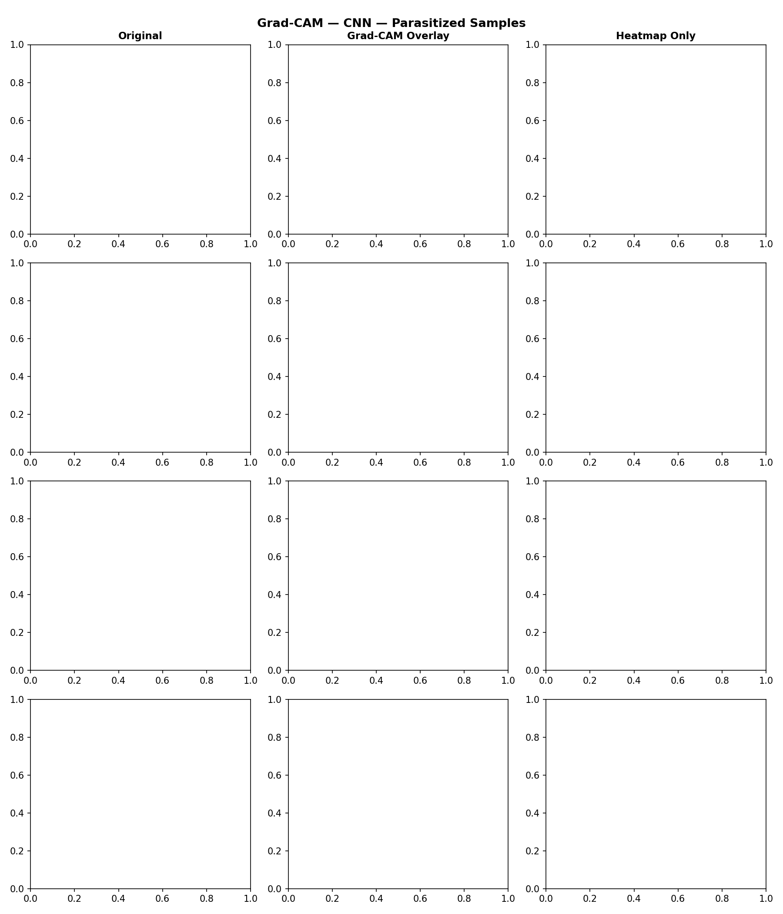
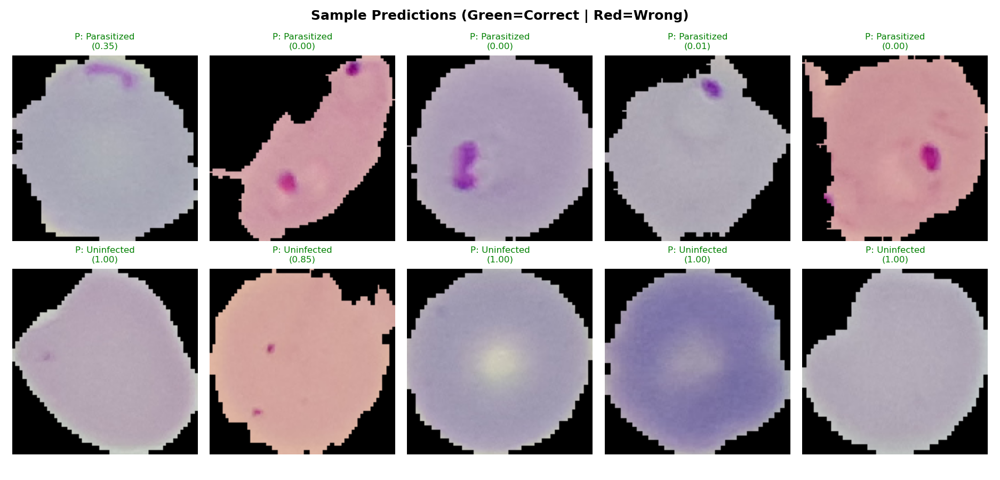

# 🔬 Malaria Cell Detection

Deep-learning classifier that detects malaria parasites in microscope images of thin-blood-smear red blood cells.
Two models are compared — a **custom CNN** trained from scratch and a **MobileNetV2** transfer-learning model — with full evaluation and **Grad-CAM** explainability.

**🚀 Live demo:** https://saanvi-malaria-cell-detection.streamlit.app

[](https://saanvi-malaria-cell-detection.streamlit.app)



---

## Features
- Data cleaning (corrupt-image removal), class-balance check, stratified 70 / 15 / 15 split
- Data augmentation (rotation, shift, zoom, flips, brightness)
- **Model 1 – Custom CNN:** 4 conv blocks with BatchNorm + Dropout + L2
- **Model 2 – MobileNetV2:** ImageNet weights, feature extraction → fine-tuning of the last 30 layers
- Evaluation: confusion matrix, classification report, ROC-AUC, precision-recall, probability distributions
- Decision-threshold optimisation (F1)
- **Grad-CAM** heatmaps showing where the model looks
- **Streamlit web app** for single-image inference with Grad-CAM overlay

## Dataset
[Cell Images for Detecting Malaria](https://www.kaggle.com/datasets/iarunava/cell-images-for-detecting-malaria) (NIH / Kaggle) — 27,558 cell images, perfectly balanced:

| Class | Images | Train | Val | Test |
|---|---|---|---|---|
| Parasitized | 13,779 | 9,645 | 2,067 | 2,067 |
| Uninfected | 13,779 | 9,645 | 2,067 | 2,067 |

The dataset is not included in this repo. To retrain, download it and extract to `data/cell_images/{Parasitized,Uninfected}`.

## Results (test set, 4,134 images)

| Model | Accuracy | Precision* | Recall* | F1* | ROC-AUC |
|---|---|---|---|---|---|
| Custom CNN | **96.32%** | 0.9456 | 0.9831 | 0.9639 | **0.9912** |
| MobileNetV2 | 94.85% | 0.9229 | 0.9787 | 0.9500 | 0.9884 |
| MobileNetV2 @ threshold 0.83 | 95.28% | 0.9535 | 0.9521 | 0.9528 | 0.9884 |

\* computed with *Uninfected* as the positive class (Keras label 1).
At the F1-optimal threshold (0.83) the MobileNetV2 model reaches **95.4% recall on Parasitized cells**, which is the number that matters most clinically. The web app uses this model and threshold: it is less than half the size of the CNN (24 MB vs 55 MB) and loads quickly on free hosting.

| | |
|---|---|
|  |  |
|  |  |
|  |  |

More plots (training curves, PR curves, threshold optimisation) are in [`results/`](results/).

## Project structure
```
├── app.py                          # Streamlit prototype
├── Malaria_Cell_Detection.ipynb    # Full training + evaluation notebook
├── models/
│   └── malaria_mobilenet_model.keras
├── results/                        # Evaluation plots
├── samples/                        # Example cell images for the demo
├── requirements.txt
└── runtime.txt                     # Python 3.11 for Streamlit Cloud
```

## Run the app locally
Requires Python 3.9–3.12 (TensorFlow does not support newer versions yet).

```bash
python -m venv .venv
# Windows: .venv\Scripts\activate   |   macOS/Linux: source .venv/bin/activate
pip install -r requirements.txt
streamlit run app.py
```
Then open http://localhost:8501, upload a cell image (or pick a sample) and see the prediction with its Grad-CAM heatmap.

## Deploy (Streamlit Community Cloud)
1. Push this repo to GitHub.
2. Go to [share.streamlit.io](https://share.streamlit.io) → **New app** → select the repo, branch `main`, file `app.py`.
3. Under **Advanced settings** choose Python 3.11, then **Deploy**.

## Note on labels
Keras `flow_from_directory` assigns class indices alphabetically: `0 = Parasitized`, `1 = Uninfected`.
The sigmoid output is therefore **P(Uninfected)**.

## Disclaimer
Research / educational prototype only. Not validated for clinical use.
